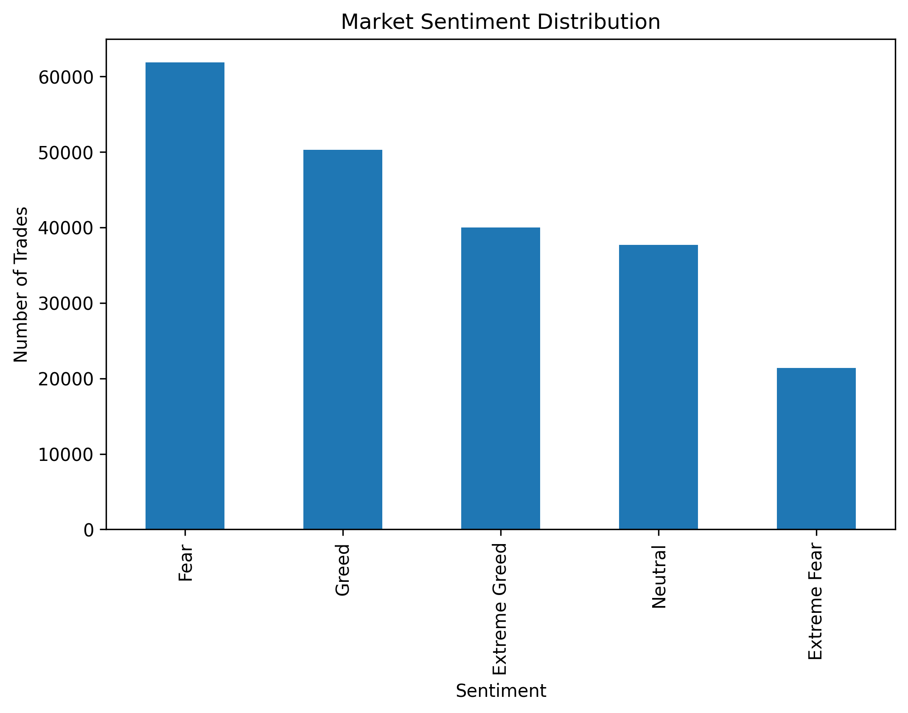
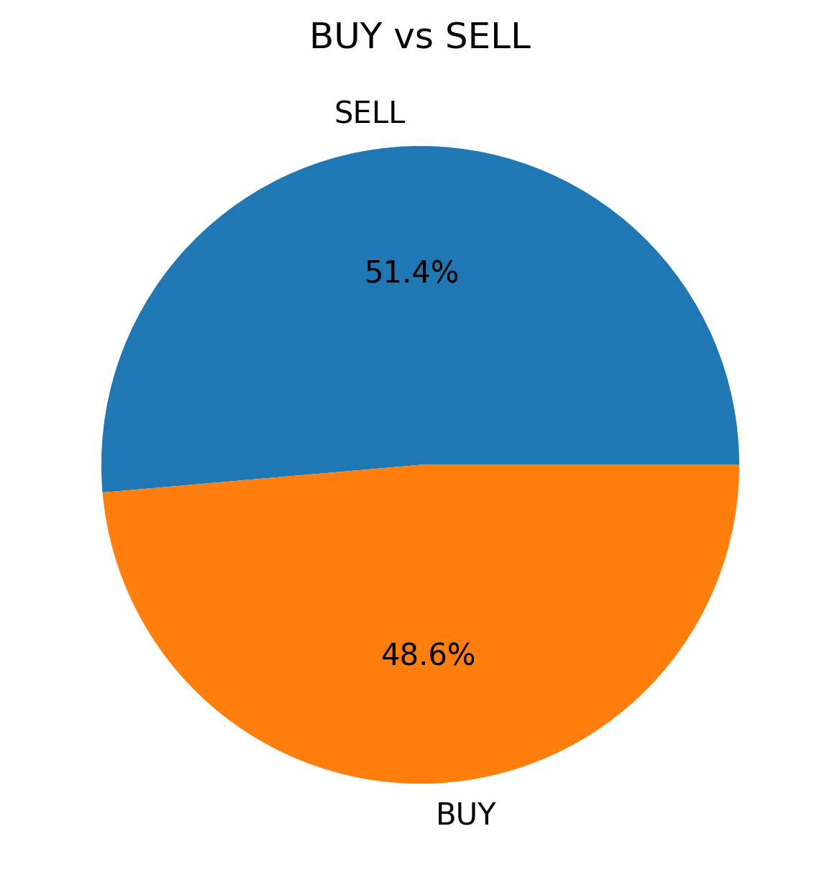
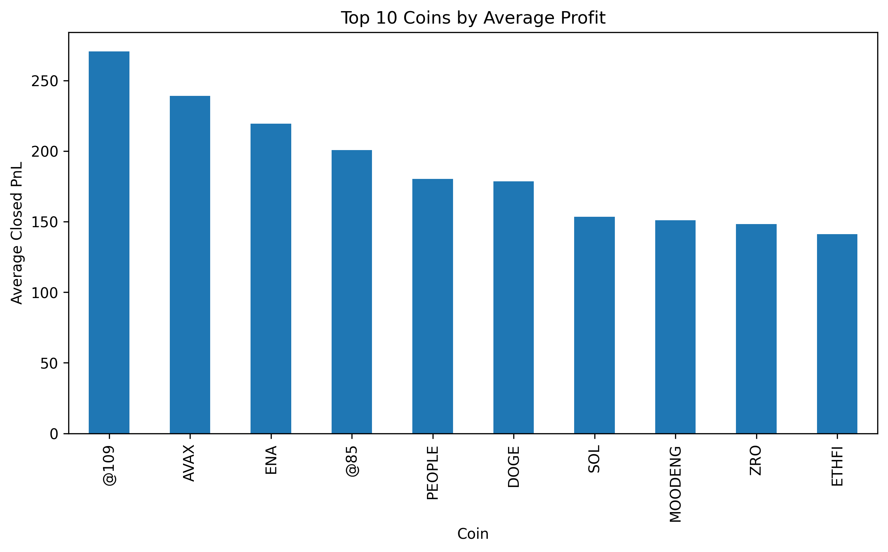
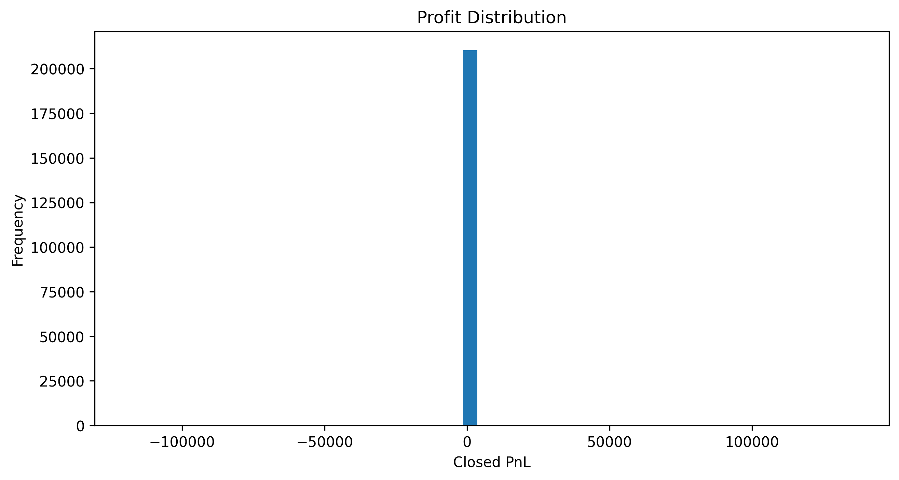
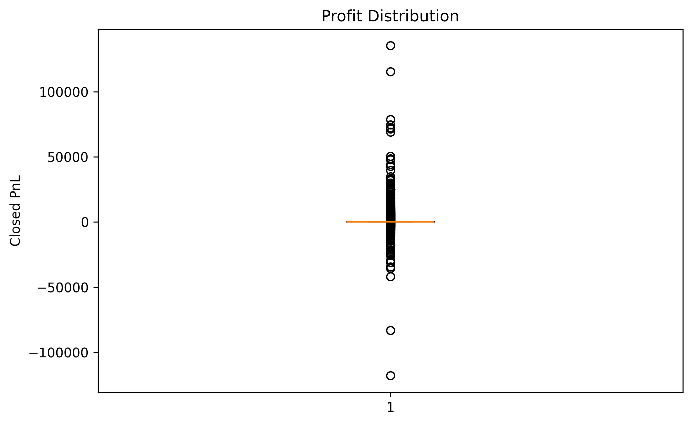
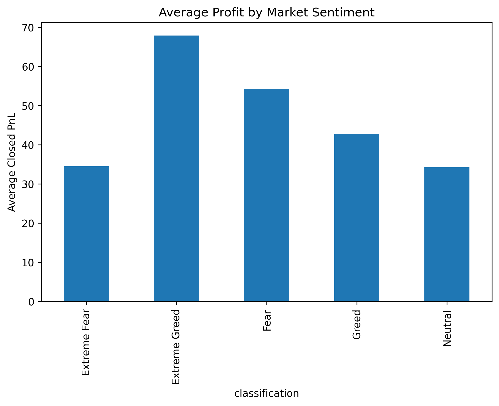
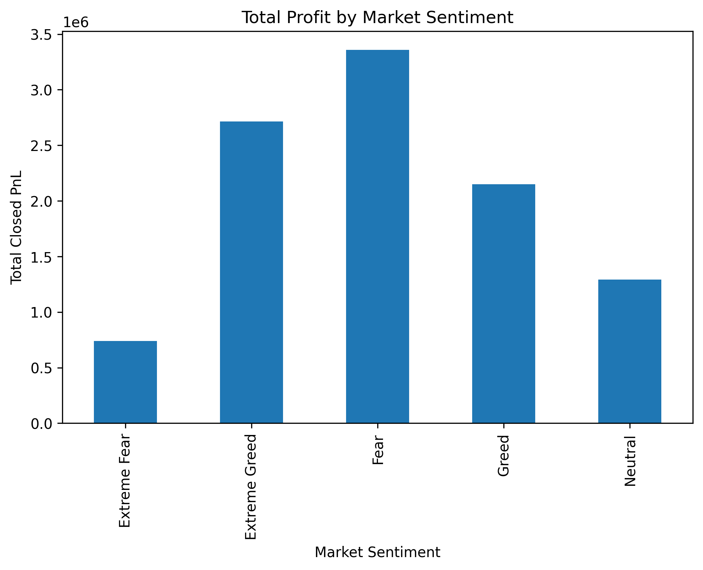
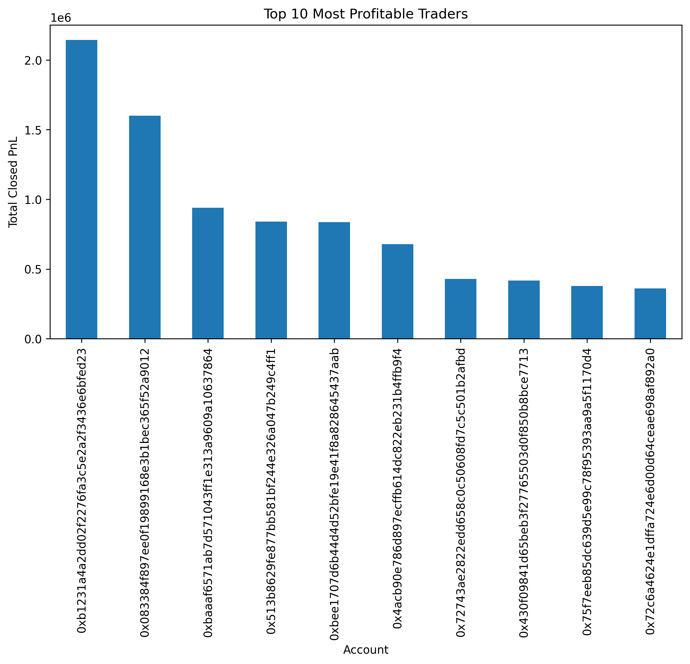
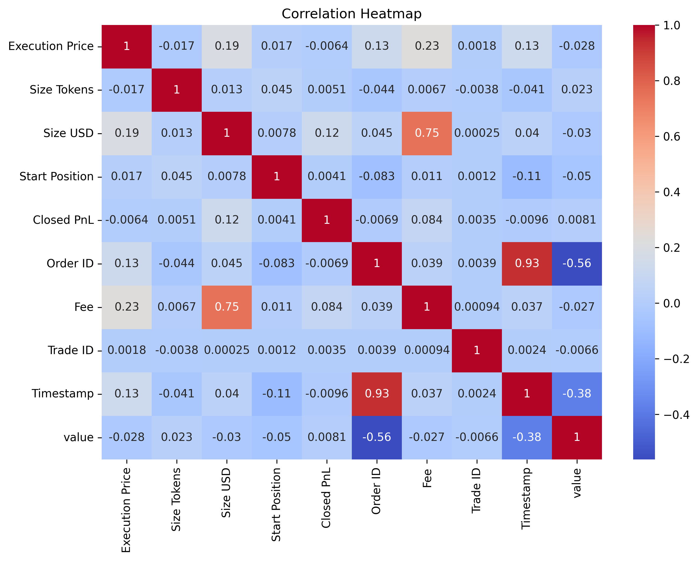
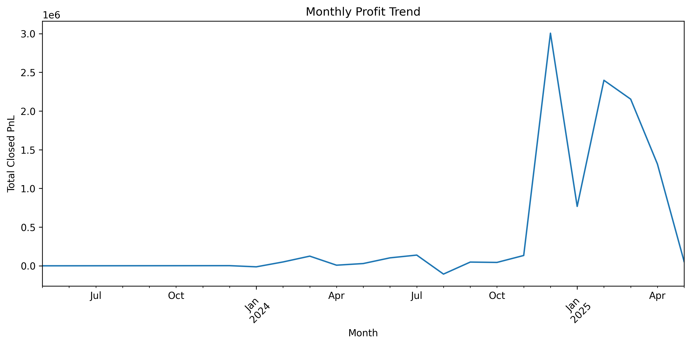

# 📈 Bitcoin Market Sentiment Analysis

## 📌 Project Overview

This project explores the relationship between **Bitcoin Market Sentiment (Fear & Greed Index)** and **trader performance** using historical cryptocurrency trading data. By combining market sentiment data with trading records, the analysis identifies patterns that can help traders and analysts understand how market emotions influence profitability.

---

## 🎯 Objective

The objective of this project is to:

- Analyze Bitcoin Fear & Greed Index data.
- Merge market sentiment with historical trading records.
- Perform Exploratory Data Analysis (EDA).
- Discover relationships between market sentiment and trader profitability.
- Generate actionable insights that support data-driven trading decisions.

---

## 📂 Project Structure

```text
Bitcoin-Market-Sentiment-Analysis/
│
├── images/
│   ├── average_profit.png
│   ├── buy_sell.png
│   ├── correlation_heatmap.png
│   ├── market_sentiment.png
│   ├── monthly_profit_trend.png
│   ├── profit_distribution.png
│   ├── profit_distribution_boxplot.png
│   ├── top_coins.png
│   ├── top_traders.png
│   ├── total_profit.png
│   └── win_rate_by_market_sentiment.png
│
├── Bitcoin_Market_Sentiment_Analysis.ipynb
├── historical_data.csv
├── fear_greed_index.csv
├── requirements.txt
└── README.md
```

---

# 🛠️ Technologies Used

- Python
- Pandas
- NumPy
- Matplotlib
- Seaborn
- Jupyter Notebook

---

# 📊 Exploratory Data Analysis

## 1️⃣ Market Sentiment Distribution



This chart shows the number of trades executed under different Bitcoin market sentiment categories such as Fear, Greed, Neutral, Extreme Fear, and Extreme Greed.

---

## 2️⃣ BUY vs SELL Distribution



This pie chart illustrates the proportion of BUY and SELL trades in the dataset, providing an overview of trader market positions.

---

## 3️⃣ Top 10 Most Traded Coins



This visualization highlights the cryptocurrencies with the highest trading activity.

---

## 4️⃣ Profit Distribution



The histogram displays the distribution of trader profits and losses, helping identify the frequency of different profit ranges.

---

## 5️⃣ Profit Distribution (Box Plot)



The box plot summarizes trader profits, highlighting the median, interquartile range (IQR), and potential outliers.

---

## 6️⃣ Average Profit by Market Sentiment



This chart compares the average profit earned under different market sentiment conditions.

---

## 7️⃣ Total Profit by Market Sentiment



This visualization shows the cumulative profit generated under each Bitcoin market sentiment category.

---

## 8️⃣ Top 10 Most Profitable Traders



Ranks the top-performing traders based on their cumulative Closed PnL.

---

## 9️⃣ Correlation Heatmap



The heatmap illustrates correlations between numerical variables in the dataset, helping identify important relationships.

---

## 🔟 Win Rate by Market Sentiment



This chart compares the percentage of profitable trades across different market sentiment categories.

---

## 1️⃣1️⃣ Monthly Profit Trend


The line chart displays how total trader profits changed over time, highlighting monthly performance trends.

---

# 🔍 Key Insights

- Market sentiment has a measurable impact on trader profitability.
- Traders generally achieved higher average profits during periods of **Greed** compared to **Fear**.
- Total profit varies significantly across different market sentiment categories.
- A small number of traders generated a large share of overall profits.
- Certain cryptocurrencies consistently produced higher average returns.
- Profit distributions contain several outliers, indicating occasional exceptionally profitable or loss-making trades.
- Win rates differ across market sentiment categories, suggesting that trading success is influenced by overall market psychology.
- Monthly profit trends reveal periods of stronger and weaker trading performance.

---

# 💡 Business Recommendations

- Incorporate Bitcoin Fear & Greed Index into trading decision-making.
- Monitor market sentiment before opening large trading positions.
- Analyze historical performance under different market conditions to improve strategy selection.
- Pay attention to top-performing cryptocurrencies during favorable market sentiment.
- Use risk management strategies during periods of Extreme Fear and Extreme Greed.

---

# 🚀 Future Improvements

- Develop a Machine Learning model to predict trader profitability.
- Build a real-time Streamlit dashboard.
- Integrate live Bitcoin Fear & Greed API.
- Perform advanced feature engineering for predictive analytics.
- Deploy the project as a web application.

---

# 📦 Installation

Clone the repository:

```bash
git clone https://github.com/yourusername/Bitcoin-Market-Sentiment-Analysis.git
```

Install dependencies:

```bash
pip install -r requirements.txt
```

Launch Jupyter Notebook:

```bash
jupyter notebook
```

Open:

```
Bitcoin_Market_Sentiment_Analysis.ipynb
```

---

# 📚 Dataset

The project uses two datasets:

- Historical Cryptocurrency Trading Data
- Bitcoin Fear & Greed Index Data

These datasets are merged based on trading dates to analyze the relationship between market sentiment and trader performance.

---

# 👨‍💻 Author

**Sharddha Ghadge**

Computer Science Student

Passionate about AI, Machine Learning, Data Science, and Data Analytics.

---

# ⭐ If you found this project useful, consider giving it a star!
